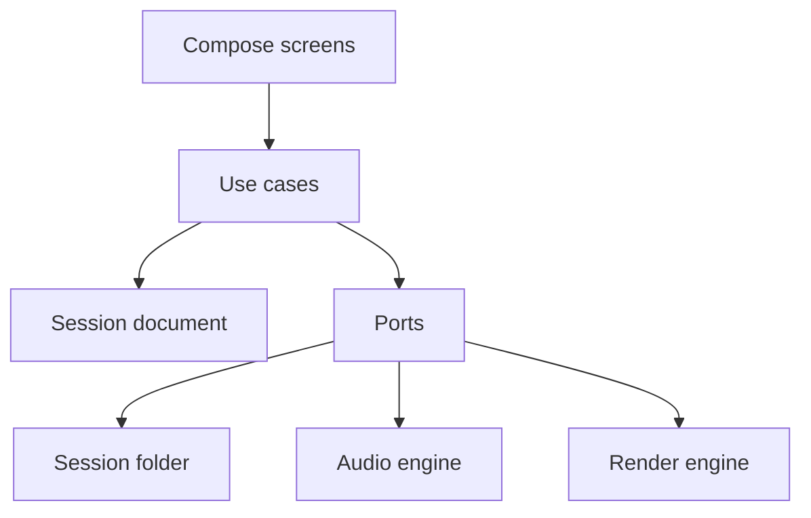

# SwaraLab architecture

SwaraLab is a local singer studio. A performance is a folder on the phone. Screens edit that folder through use cases. Microphones, cameras, and file export sit behind ports so they can be connected without reshaping the app.

The license is Apache-2.0. The app ships with no commercial songs. A backing track enters only after the singer confirms they can use it.

## Shape

```text
app
  composition root, navigation, Create screen
feature:library    feature:studio    feature:publish
  screens and view models
core:ui
  theme and shared controls
engine:audio       engine:render
  AudioEngine and RenderEngine adapters
core:session
  folder store
core:domain
  session document, commands, policies, ports, use cases
```

Dependency direction is inward. `core:domain` is plain Kotlin and does not see Android. Features see use cases and port interfaces. Only `app` sees the concrete engines and the folder store, and it passes those into the screens.



## Session folder

The folder is the source of truth. A database can index it later. It is not allowed to become the only copy.

```text
filesDir/swaralab/projects/{sessionId}/
  session.json
  media/takes/{takeId}.wav
  media/backing/
  media/video/
  media/midi/
  exports/
```

`session.json` uses the format name `swaralab.session` and version `1`. The codec refuses a newer version and ignores unknown fields, so a newer build can add fields without breaking an older file it still understands. Saves write a temp file and then move it into place.

`SessionReducer` is the only writer of document fields. Commands cover rename, listening route, latency, backing import, take commit, monitor mix, vocal chain, lyrics, section markers, musical settings, publish target, and songwriter paths. A command that would break the folder, such as a path that escapes it, or a backing track without a rights confirmation, is rejected and the previous document stays as it was.

Create makes three kinds of session from one document:

| Kind | Tracks at creation | Purpose |
| --- | --- | --- |
| Practice | Lead | Listen-back loop for learners |
| Song | Backing and lead | Originals and lawful covers |
| Video | Backing and lead | Vertical performance |

## Ports

`AudioEngine` arms a listening route, starts a take, and stops it. The current adapter applies the monitor policy and reports that the microphone path is not connected yet. The Oboe adapter will use the same interface: exclusive low-latency streams, a callback that does not allocate or touch the session file, and a writer thread that flushes a 48 kHz 16-bit mono WAV. When the take ends, a `CommitTake` command adds the clip to a lane. The dry file stays. Effects never replace it.

`RenderEngine` exports from a session and a publish target. Review playback and export will share one offline graph so the file matches the preview. The current adapter reports the loudness and peak stored on the session and waits for that graph. Media3 will mux the vertical video.

Listening policy lives in the domain, not in a screen:

| Output while recording | Decision |
| --- | --- |
| Wired, USB | Allow |
| Bluetooth | Warn. Fine for playback, late for singing in time |
| Speaker, phone mic, unset | Block, so the backing track cannot leak into the vocal |

Review playback is allowed on every route. Headphone monitoring gain is a separate field from the exported track gain.

Publish settings store the destination, frame, lyric burn-in, credits, and the common master of −14 LUFS with a true peak of −1 dBTP. Safe-area insets for Reels, Shorts, WhatsApp, square, and wide frames live next to that so the renderer and the screen share one definition.

## Threads

Compose stays on the main thread. View models call use cases, and the folder store hops to `Dispatchers.IO`. The future audio callback is a third world: no locks that can wait, no file IO, no looking up dependencies. `SwaraLabGraph` is a constructor-injected composition root for that reason. A DI framework is easy to add at the root later. It does not belong on the audio thread.

## What connects next

1. Oboe transport, crash-safe WAV, input meter, and the clap test that writes `SetLatency`.
2. CameraX video beside the same take, then Media3 mux through `RenderEngine`.
3. Offline vocal chain: denoise, breath, de-ess, compression, rider, ducking, reverb, delay. Presets Raw, Close, Stage, and Radio already have a home on the document.
4. Note editor, range check, and key shift as new commands on `musical` and the lead clips.
5. On-device lyric alignment and hum-to-MIDI behind a new port. Models download when the singer turns them on. Vocals are not uploaded for this.
6. Stem duets as another lane in the same folder, passed between phones as a project bundle.

Direct upload to a social app stays behind the share sheet until a destination file is real.
